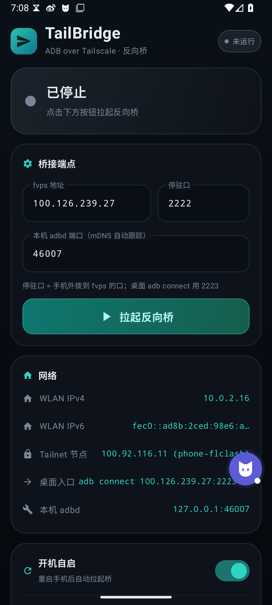
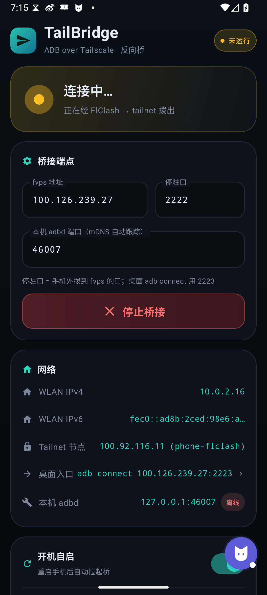
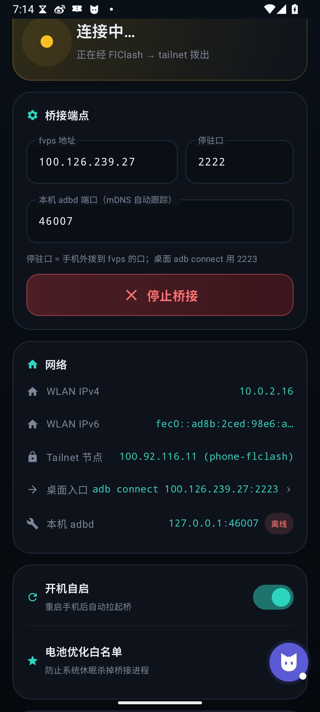

# TailBridge

**Keep wireless ADB reachable from anywhere** — an Android helper app that supervises a tiny reverse-ADB connector, parking a persistent outbound connection on your relay host so `adb connect` works through NAT/CGNAT without a second VPN.

Designed to coexist with a single-VPN setup (e.g. FlClash/mihomo with an embedded `type: tailscale` outbound): TailBridge doesn't own the VPN slot, needs no Termux, no root.

---

```
 ┌──────────┐  adb connect host:2223   ┌─────────┐   parked conn   ┌──────────────┐
 │ desktop  │ ───────────────────────▶ │ relay   │ ◀────────────── │ adbstitch    │
 │   adb    │                          │ :2223   │   (outbound,    │ (on phone,   │
 └──────────┘                          │ :2222   │    kept alive)  │  supervised) │
                                      └────┬────┘                 └──────┬───────┘
                                           │ splice the two TCP conns    │
                                           └───────────▶ 127.0.0.1:adbd ◀┘
```

- Phone → `host:2222`: outbound "park" connection held open by `adbstitch` (works on any network the phone can reach, including through a Tailscale-in-mihomo outbound).
- Desktop → `host:2223`: the relay splices your `adb` connection onto the parked one; the phone side then lazily dials `127.0.0.1:<wireless-debugging port>` at handshake time.

## Screenshots

<p>
  
  
  
</p>

## Features

- **Foreground-service watchdog** — respawns the connector within ~1.5 s if it dies; optional boot autostart
- **Auto port discovery** — mDNS (`_adb-tls-connect._tcp`) on Wi-Fi; off-Wi-Fi it scans loopback for the adbd listener (TLS banner **and** legacy-adb `CNXN` probe, so `adb tcpip` ports are found too)
- **Manual port lock** — typing a port locks it in place (needed for pair-port relay and the stable `tcpip 5555` listener); tap the lock to return to auto-discovery
- **Live status** — parked / bridged / reconnecting state, adbd online probe, WLAN/Tailnet addresses, one-tap copy of the desktop `adb connect` command
- **Self-healing transport** — the connector re-parks on a 90 s idle timeout so dead-without-FIN zombie connections recover on their own
- **Polished Material3 UI** — dark theme, state-driven colors, haptics

## Repository layout

```
app/        Android app (Kotlin + Jetpack Compose, Material3)
native/     adbstitch.c — ~130-line static C connector (poll-based TCP splice)
bridge/     adb_bridge2.py — asyncio splice relay for the server side
docs/       screenshots
```

## Build

```bash
# 1. Build the connector binary (needs Android NDK) — produces a fake .so
native/build.sh           # auto-detects $ANDROID_HOME/ndk; or set NDK_HOME

# 2. Build the APK
gradle :app:assembleDebug # or ./gradlew if you generate a wrapper
```

## Deploy & use

1. On a host the phone can reach (a VPS, e.g. your Tailnet node), run:

   ```bash
   python3 bridge/adb_bridge2.py        # listens on 2222 (park) + 2223 (adb)
   ```

   Bind it to your tailnet IP if you only want tailnet access.

2. Install the APK, open **TailBridge**, set `fvps 地址` / `停驻口`, tap **拉起反向桥**.

3. From the desktop:

   ```bash
   adb connect <host>:2223
   adb -s <host>:2223 shell getprop ro.product.model
   adb -s <host>:2223 forward tcp:9222 localabstract:chrome_devtools_remote
   ```

Wireless debugging must be enabled on the phone (Developer options → Wireless debugging). ADB's normal TLS + pairing authorization still applies — the bridge doesn't weaken authentication.

## ADB over cellular (no Wi-Fi)

The wireless-debugging listener dies without a Wi-Fi association — but the **legacy `adb tcpip` listener doesn't**. One-time setup whenever you do have a session (any Wi-Fi, or USB):

```bash
adb tcpip 5555          # opens a persistent adb listener on 0.0.0.0:5555
```

Then set TailBridge's adbd port to `5555` (it locks automatically). The listener survives Wi-Fi loss, so adb keeps working on cellular until the next reboot. Verified end-to-end on ColorOS over Tailscale + cellular.

Notes:

- `tcpip 5555` is the classic unencrypted adb protocol — standard adb auth still applies (paired keys work; unknown keys trigger the "Allow USB debugging" prompt).
- Fresh keys can also be **paired through the bridge**: open the pairing dialog on the phone, lock the adbd field to the pair port shown there, then `adb pair <host>:2223 <code>` from the desktop. Works for connect ports too — `adb pair`/`adb connect` see only raw TCP.
- With the official Tailscale app as the active VPN, tailnet traffic is forwarded to the phone's loopback — `adb connect <tailnet-ip>:5555` then works **without the bridge at all**.

## Limitations

- Wireless debugging (the TLS listener) still requires a Wi-Fi association to start — the `tcpip` listener above is the workaround for pure-cellular use, and must be re-armed after each reboot.
- adbd has a ~1–3 min cooldown after transport loss (LAN included) — retries are normal.
- One concurrent adb session per parked connection (by design).

---

# TailBridge（中文）

让**无线 ADB 突破网络限制**——Android 小助手 App，守护一个极小的反向连接器：手机主动把一条出站连接"停驻"到你的中继机上，桌面 `adb connect` 经由中继拼接直达手机。适配单 VPN 槽架构（如 FlClash/mihomo 内嵌 `type: tailscale` 出站）——不占用 VPN 槽、不需要 Termux、不需要 root。

## 特性

- 前台服务看门狗，进程死亡 ~1.5s 内重拉；可选开机自启
- 端口自动侦查：WiFi 下走 mDNS；无 WiFi 时扫 loopback(TLS + CNXN 双探针，`adb tcpip` 端口也能找到)
- 手动端口锁定：手填即锁定（配对转发 / 固定 5555 用），点锁恢复自动
- 实时状态：停驻/桥接/重连 + adbd 在线探测 + 一键复制 adb 命令
- 90s 停驻超时自愈，僵尸连接自动重建
- Material3 深色 UI，状态驱动配色 + 触感反馈

## 使用

1. 中继机跑 `python3 bridge/adb_bridge2.py`（2222 停驻口 / 2223 adb 口，建议绑定 tailnet IP）
2. 手机装 APK → 填地址 → 点"拉起反向桥"
3. 桌面 `adb connect <主机>:2223` 即可

要求开发者选项里打开"无线调试"；adb 本身的 TLS+配对认证不变。

## 纯蜂窝（无 WiFi)adb

无线调试监听没有 WiFi 关联就不启动——但 **`adb tcpip` 的经典监听不受此限**。趁有 WiFi/USB 时执行一次：

```bash
adb tcpip 5555          # 打开 0.0.0.0:5555 持久监听
```

TailBridge 端口填 `5555`（自动锁定）。该监听在 WiFi 断开后依然存活，蜂窝下 adb 照常可用，直到重启（重启后需重做）。已在 ColorOS + Tailscale + 蜂窝下实测通过。

- 5555 是未加密 adb 协议——认证照旧（已配对 key 直接通，陌生 key 触发"允许 USB 调试"弹窗）
- 配对也能走桥：手机打开配对弹窗 → TailBridge 端口锁到弹窗里的 pair 端口 → 桌面 `adb pair <host>:2223 <码>`
- 若官方 Tailscale App 是活跃 VPN,tailnet 入站会转发到本机 loopback——`adb connect <tailnet-ip>:5555` **不需要桥直连**

## 已知边界

- 无线调试（TLS 监听）仍需 WiFi 关联才能启动——纯蜂窝靠上面的 `tcpip` 方案，重启后需重新执行
- transport 断开后 adbd 有 1–3 分钟冷却窗，重试即可

## License

MIT
